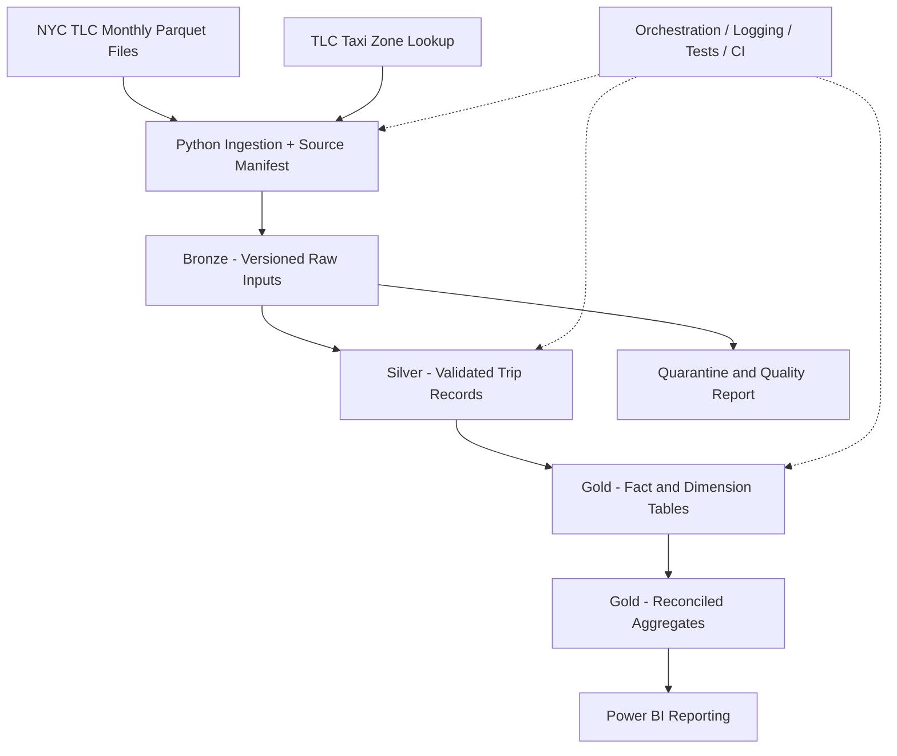

# Urban Mobility Intelligence Platform

**A production-oriented, batch data engineering portfolio project using public NYC yellow-taxi records.**

> **Status: Phase P0 — Foundation (in progress).** This repository documents a planned system. Data pipelines, automated tests, dashboards, and performance improvements are **not yet implemented**. Status and claims will be updated as each milestone passes acceptance tests.

## Why build this?

Public NYC Taxi & Limousine Commission (TLC) monthly Parquet files are useful for exploring genuine data engineering trade-offs: source changes, imperfect data, reliable ingestion, data-quality decisions, incremental updates and reproducible reporting.

**Engineering objective:** Create a repeatable pipeline that can ingest multiple monthly files, preserve original inputs, validate and classify records, publish trustworthy analytical data marts, and recover without double-counting.

**Business questions:**
- How do trip volumes vary by pickup zone and month?
- How do reported passenger charges, trip duration, and trip distance vary over time?
- What portion of each source file violates documented data-quality rules?
- Can a repeated or changed source file be processed without damaging previously published results?

## Proposed architecture



**Important:** Medallion describes progression from raw to trusted to business-ready data. The Gold layer will contain Kimball-style dimensional tables and marts. TLC monthly files do not guarantee a unique trip ID, so the planned incremental strategy is **file-version / month-level processing**, not invented row-level CDC.

## Technology plan

| Area | Intended technologies | Current status |
|---|---|---|
| Ingestion | Python, HTTP/file validation, SHA-256 manifest | Planned |
| Storage and processing | Parquet, PySpark, Delta Lake | Planned |
| Modeling | SQL, fact/dimension tables | Planned |
| Data quality | Contract checks, quarantine, reconciliation | Planned |
| Operations | Orchestration, structured logs, recovery tests | Planned |
| Testing and CI | Pytest, GitHub Actions | Planned |
| Reporting | Power BI | Planned |

Tool versions will be pinned only after compatibility tests in P0.

## Development roadmap

| Phase | Focus | Status |
|---|---|---|
| P0 | Foundation, repo, source documentation, initial profiling | **In progress** |
| P1 | Python ingestion, manifest, replay protection | Planned |
| P2 | PySpark / Delta Bronze | Planned |
| P3 | Silver, source contracts, data-quality quarantine | Planned |
| P4 | Incremental updates and failure-safe reprocessing | Planned |
| P5 | Gold dimensional model and reconciliation | Planned |
| P6 | Orchestration, monitoring, tests, CI | Planned |
| P7 | Power BI reporting | Planned |
| P8 | Optional weather/cloud/benchmark extensions | Planned |

See [full project specification](docs/PROJECT_SPEC.md), [phase roadmap](docs/roadmap.md), and [progress log](docs/progress.md).

## How to explore this repository today

1. Read [`docs/PROJECT_SPEC.md`](docs/PROJECT_SPEC.md) for scope, functional requirements, acceptance tests, and risks.
2. Read [`docs/architecture.md`](docs/architecture.md) for proposed architecture and decisions.
3. Read [`docs/adr/001-file-level-incremental.md`](docs/adr/001-file-level-incremental.md) to see a proposed engineering decision and alternatives.
4. Track development in [`docs/progress.md`](docs/progress.md) and GitHub issues/PRs.
5. Source profiling results and executable setup commands will be added as implemented and verified.

**No runnable pipeline has been published yet.** Instructions will be expanded with tested setup and commands in later phases.

## Repository layout

```text
.github/               Issue and PR templates
configs/               Versioned source contracts and pipeline config (planned)
data/                  Local, git-ignored downloads and working datasets
dashboards/            Reporting outputs after validation
docs/                  Specification, architecture, ADRs, profiles, evidence
notebooks/             Exploratory analysis; not the production pipeline
scripts/               Operational and setup commands (planned)
sql/                   Analytical definitions and reconciliation SQL (planned)
src/urban_mobility/     Testable application modules (planned)
tests/                 Unit, Spark, and integration tests (planned)
```

## Dataset and attribution

- [NYC TLC Trip Record Data](https://www.nyc.gov/site/tlc/about/tlc-trip-record-data.page)
- [NYC TLC yellow-taxi data dictionary](https://www.nyc.gov/assets/tlc/downloads/pdf/data_dictionary_trip_records_yellow.pdf)
- [Taxi Zone Lookup CSV](https://d37ci6vzurychx.cloudfront.net/misc/taxi_zone_lookup.csv)
- Optional, later: [Open-Meteo historical weather](https://open-meteo.com/en/docs/historical-weather-api)

Start with **January 2025**, then add February and March 2025. Source accuracy/completeness is not guaranteed by TLC. Downloaded raw trip datasets will **not** be committed to GitHub.

## Evidence policy

Features are marked implemented only after code and checks exist. Published results must contain measured values, a documented command, expected/actual outcome and limitations. Synthetic test faults will be explicitly identified as simulations, not attributed to the TLC.

## Project participation and history

This is an actively developed learning/engineering portfolio project. Each milestone will be tracked via descriptive commits, issues and pull requests. See [contribution and branching workflow](CONTRIBUTING.md).

_Initial repository scaffold: November 5, 2026._
