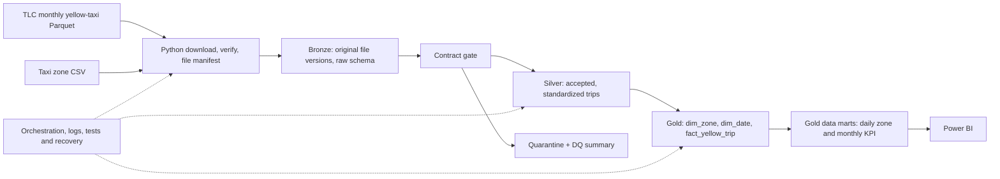

# Proposed architecture — P0

**Status:** design proposal, not a description of an implemented system.

## Architectural boundaries

- **Unit of ingestion:** an immutable version of a published TLC source-month file, identified by source type, month and SHA-256 hash.
- **Unit of reporting publication:** source month, with validated replacements and a published-version pointer/manifest.
- **Bronze:** preserves raw input versions and their lineage.
- **Silver:** applies contracts, cleaning, accepted vs. quarantined rules, and reconciliation.
- **Gold:** contains dimensional model **and** business-ready aggregates, not a separate mandatory post-Gold modeling stage.
- **No row-level CDC claims:** TLC monthly Parquet files do not supply a guaranteed trip ID or source change stream.
- **Optional future weather data:** joins at daily grain with explicit join-cardinality checks.

## Design decisions to verify

See [ADR 001](adr/001-file-level-incremental.md). Before implementation, confirm local Spark/Delta/Java compatibility, available disk/RAM, source schema, data-quality policy, and publish atomicity guarantees.

## Planned operations

Manifest tracking; structured run logs; contract gates; quarantine; per-month reconciliation; safe replays; failure recovery; CI. These are future deliverables, **not** deployed functionality at P0.
